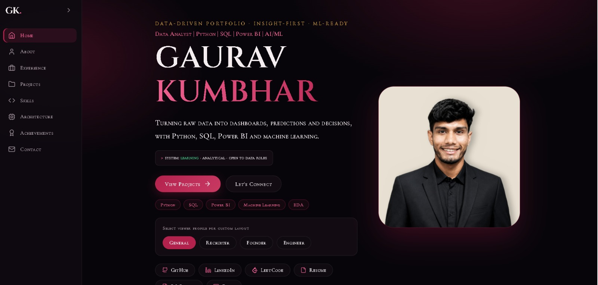
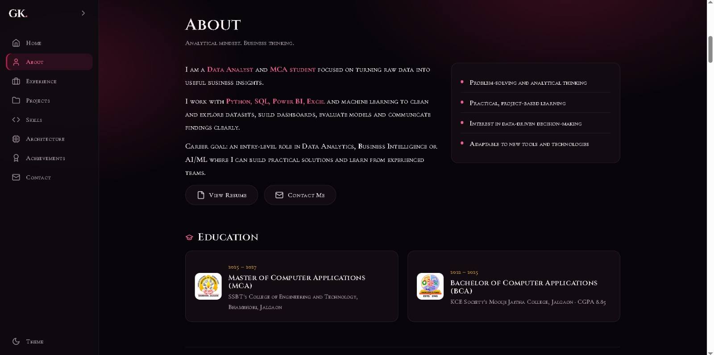
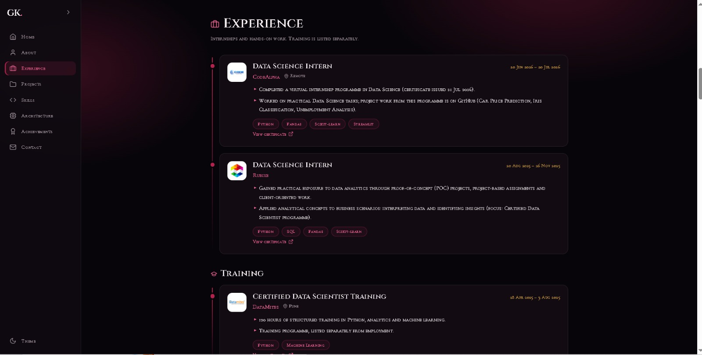
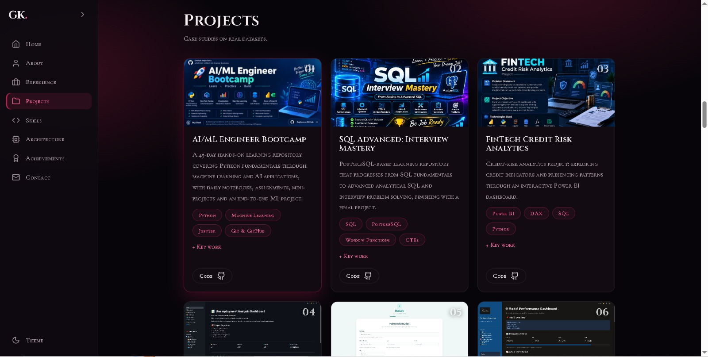
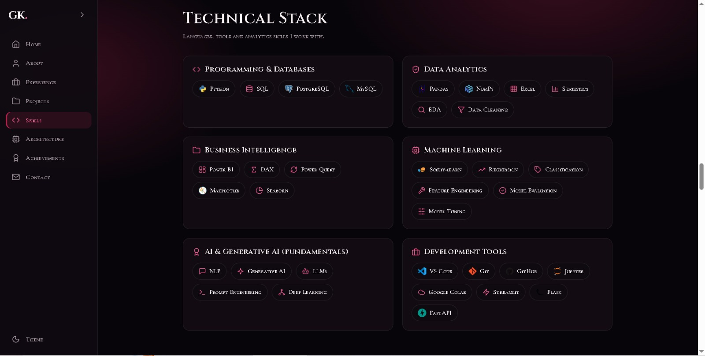
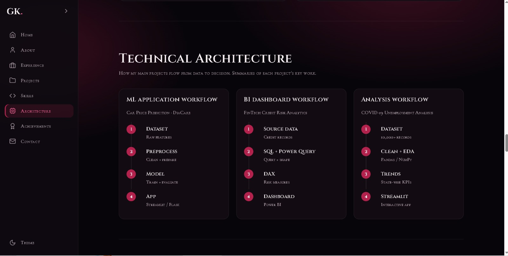
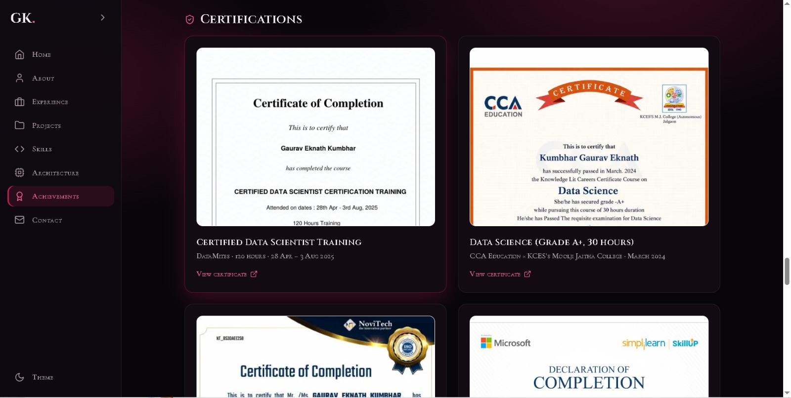
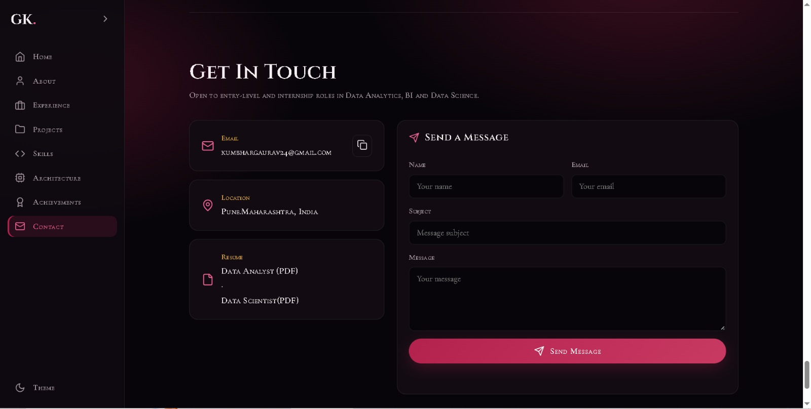

# GK. — Personal Portfolio Website

### A Data-Driven Portfolio | Insight-First | ML-Ready

A modern, responsive, multi-page personal portfolio website built using **HTML5, CSS3, and JavaScript**.

The website features a premium dark burgundy visual identity, elegant typography, interactive navigation, project showcases, professional experience, technical skills, architecture workflows, certifications, and a contact form.

Designed to provide visitors, recruiters, and developers with an engaging way to explore the portfolio.

---

## 🌐 Website Overview

- **Project:** GK. Personal Portfolio
- **Type:** Personal Portfolio Website
- **Frontend:** HTML5, CSS3, JavaScript
- **Design:** Dark Burgundy / Minimal / Elegant
- **Layout:** Responsive Sidebar Navigation
- **Theme:** Dark Mode and Light Mode
- **Architecture:** Static Website
- **Build System:** No build step required
- **Deployment:** GitHub Pages, Netlify, Vercel, Render

---

## 🖥️ Website Preview

<p align="center">
  
</p>

<p align="center">
  <b>GK. — Personal Portfolio Website</b><br>
  <i>Data-Driven Portfolio · Insight-First · ML-Ready</i>
</p>

---

## 📑 Website Pages & Sections

The portfolio is organized into eight main navigation sections.

### 01. 🏠 Home

The main landing section introduces the portfolio through:

- Large typographic hero section.
- Professional role and technology tagline.
- Profile photograph.
- Short introduction and call-to-action buttons.
- Technology badges.
- Interactive viewer-profile switcher.
- Quick links to GitHub, LinkedIn, LeetCode, and Resume.


### 02. 👤 About

A dedicated introduction section presenting:

- Professional introduction.
- Analytical mindset and interests.
- Technical approach and working philosophy.
- Career goals.
- Education details.
- College logos.
- Resume and contact shortcuts.



### 03. 💼 Experience

A structured professional journey section featuring:

- Internship experience.
- Organization details and logos.
- Internship duration.
- Responsibilities and practical learning.
- Technical tools used.
- Training programs.
- Certificate links.



### 04. 🚀 Projects

An interactive project showcase presenting practical development and analytical work.

Featured projects include:

- AI/ML Engineer Bootcamp
- SQL Advanced: Interview Mastery
- FinTech Credit Risk Analytics
- Unemployment Analysis
- DiaCare ML Application
- Car Price Prediction
- Machine Learning Classification Projects

Project cards include:

- Project thumbnails and screenshots.
- Descriptions and objectives.
- Technology tags.
- Key project highlights.
- GitHub repository links.
- Live demo links where available.



### 05. 🛠️ Skills

A categorized technical skills dashboard organized into:

- Programming and Databases
- Data Analytics
- Business Intelligence
- Machine Learning
- AI and Generative AI Fundamentals
- Development Tools

Technologies are displayed using recognizable logos, icons, and interactive-style skill badges.



### 06. ⚙️ Technical Architecture

A visual explanation of how selected projects process data and produce results.

Three major workflows:

**Machine Learning Application**
1. Dataset
2. Preprocessing
3. Model Training
4. Application

**Business Intelligence Dashboard**
1. Source Data
2. SQL and Power Query
3. DAX
4. Power BI Dashboard

**Data Analysis**
1. Dataset
2. Cleaning and EDA
3. Trend Analysis
4. Interactive Application



### 07. 🏆 Achievements

A dedicated section for professional development and accomplishments.

Features include:

- Certification cards.
- Certificate preview images.
- Issuing organization.
- Course and achievement details.
- Certificate PDF links.
- Training and competition achievements.



### 08. 📬 Contact

A contact section designed to make communication straightforward.

Includes:

- Email information.
- Location information.
- Resume download links.
- Contact form.
- Name, email, subject, and message fields.
- Email delivery integration through Formspree.
- Email-app fallback when the form is not configured.



---

## ✨ Website Features

| Feature | Description |
|---|---|
| Responsive Design | Adapts to different screen sizes |
| Sidebar Navigation | Easy access to portfolio sections |
| Collapsible Sidebar | Expandable and compact navigation |
| Theme Toggle | Dark and light appearance |
| Viewer Profile Switcher | General, Recruiter, Founder, Engineer views |
| Project Showcase | Visual project cards and links |
| Certificate Gallery | Certificate previews and PDF links |
| Architecture Workflows | Visual project-process explanations |
| Contact Form | Visitor message submission |
| Resume Access | Links to downloadable resumes |
| Social Links | GitHub, LinkedIn, and LeetCode |

---

## 🎨 Design System

The website uses a consistent visual language throughout its sections.

| Element | Design |
|---|---|
| Primary Background | Deep Charcoal |
| Secondary Background | Dark Burgundy |
| Accent Color | Burgundy / Rose Pink |
| Primary Text | White |
| Secondary Text | Silver Gray |
| Cards | Dark Charcoal |
| Borders | Subtle Dark Gray |
| Typography | Elegant Serif and Supporting Text |

**Design principles:**
- Minimal and elegant layouts.
- Clear visual hierarchy.
- Consistent spacing and alignment.
- Rounded cards and subtle borders.
- Strong typography.
- Consistent navigation across sections.

---

## 🧰 Technologies Used

| Technology | Purpose |
|---|---|
| HTML5 | Website structure |
| CSS3 | Styling, layouts, responsiveness |
| JavaScript | Interactions and functionality |
| SVG | Icons and visual elements |
| Google Fonts | Typography |
| Technology Logos | Visual representation of tools |
| Formspree | Contact form integration |
| Git | Version control |
| GitHub | Source code management |

---

## 📂 Project Structure

```text
gaurav-portfolio/
│
├── index.html
├── about.html
├── projects.html
├── skills.html
├── achievements.html
├── contact.html
│
├── css/
│   └── style.css
│
├── js/
│   └── script.js
│
├── screenshots/
│   ├── portfolio-homepage.png
│   ├── about-page.png
│   ├── experience-page.png
│   ├── projects-page.png
│   ├── skills-page.png
│   ├── architecture-page.png
│   ├── achievements-page.png
│   └── contact-page.png
│
├── project-images/
│
├── certificates/
│
├── resume/
│
└── README.md
```

---

## ⚙️ Run Locally

This is a static website with no complicated installation or build process.

**1. Clone the repository**

```bash
git clone https://github.com/GAURAV24-CODE/gaurav-portfolio.git
```

**2. Open the project folder**

```bash
cd gaurav-portfolio
```

**3. Start a local server**

```bash
python -m http.server 8000
```

**4. Open in your browser**

```text
http://localhost:8000
```

Alternatively, open `index.html` directly in your browser.

---

## 📧 Contact Form Configuration

The contact form uses Formspree for message delivery.

1. Create an account at [Formspree](https://formspree.io/).
2. Create a new form.
3. Copy the generated endpoint.
4. Configure `FORM_ENDPOINT` in `js/script.js`.
5. Test the form before publishing.

Until configured, the website uses an email-app fallback.

---

## 🚀 Deployment

The portfolio can be deployed using any static website hosting platform.

| Platform | Deployment Method |
|---|---|
| GitHub Pages | Connect GitHub repository |
| Netlify | Deploy project folder |
| Vercel | Static website deployment |
| Render | Static Site hosting |

No build command is required. Use the repository root as the publish directory.

---

## 🔒 Privacy & Security

- Sensitive personal documents should not be published.
- Redact personal identifiers from publicly shared certificates.
- Never commit private API credentials.
- Review downloadable documents before deployment.
- Configure the contact form before production use.

---

## 🎯 Project Objectives

- Build a professional online presence.
- Present projects in a visually engaging format.
- Organize experience, education, skills, and certifications.
- Demonstrate frontend development skills.
- Create an accessible way for visitors to explore technical work.
- Provide direct access to project repositories and demonstrations.

---

## 👨‍💻 Developer

**Designed and Developed by Gaurav Kumbhar**

- GitHub: [GAURAV24-CODE](https://github.com/GAURAV24-CODE)
- LinkedIn: [Gaurav Kumbhar](https://www.linkedin.com/in/gauravkumbhar24/)

---

<p align="center">
  <b>GK. — Turning Data Into Insights.</b>
</p>

<p align="center">
  Built with HTML, CSS & JavaScript ❤️
</p>

<p align="center">
  © 2026 Gaurav Kumbhar
</p>